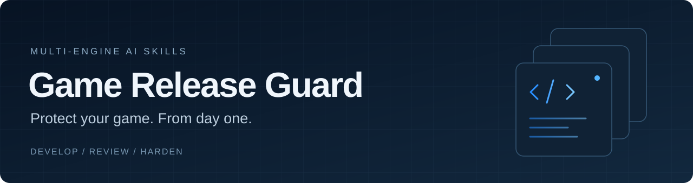

<p align="center"><a href="README.md">简体中文</a> | <a href="README.en.md">English</a></p>



<h1 align="center">Game Release Guard</h1>
<p align="center"><strong>Protect your game. From day one.</strong><br/>从开发第一天开始，保护你的游戏。</p>
<p align="center">One security development and hardening Skill for Unity, Unreal, Godot, Cocos Creator and GameMaker, with local release tools for Unity and Unreal.</p>

<p align="center"><a href="README.md">简体中文</a> | <a href="README.en.md">English</a></p>

[](https://github.com/huangzhuzhu75-bit/game-release-guard/actions/workflows/test.yml)
[](#status)
[](#quick-start)
[](LICENSE)

**Multi-Engine AI Skills V1.0 · Local toolkit: Early Development / Advanced Protection Candidate.** P0, P3 and the standalone Skill are integrated into `main`. The program version remains `0.2.0.dev0`; this is not a Stable or Production Ready release. Get the source from [main ZIP](https://github.com/huangzhuzhu75-bit/game-release-guard/archive/refs/heads/main.zip) or Git. [Releases](https://github.com/huangzhuzhu75-bit/game-release-guard/releases) lists actual publications only; no stable distribution is available.

[Quick start](#quick-start) · [Install the Skill](#ai-skill) · [Capabilities](#advanced) · [Security boundaries](#boundaries) · [Evidence](#validation) · [Support the project](#sponsoring)

## Core capabilities

| Feature | What it provides |
|---|---|
| **AI Secure Development** | Engine-aware secure development from project initialization, without extra security reports. |
| **Existing Project Protection** | Review requests stay read-only; explicit hardening requests lead to backed-up, scoped edits and compatibility checks. |
| **Unity & Unreal Release Toolkit** | Existing local CLI / Tkinter GUI for backups, restore, configuration, release checks, opt-in advanced flows and rollback. |
| **Godot Security Skill** | GDScript export, PCK AES-256, custom templates, key handling and patch/mod provenance guidance. |
| **Cocos Creator Security Skill** | Version-aware Native / Web boundaries, Encrypt JS, JSC, script backups and resource/hot-update checks. |
| **GameMaker Security Skill** | Runtime and VM / YYC distinctions, development features, Included Files, client data and release checks. |

**One Skill covers five engines.** Unity and Unreal have local CLI / GUI support. Godot, Cocos Creator and GameMaker currently use AI-guided project edits only, with no local automated encryption tool.

<a id="quick-start"></a>
## 30-second quick start

**Just want the AI guidance? Download the [complete Skill ZIP](downloads/game-release-guard-skill.zip) and give your assistant the [universal prompt](#use-with-ai) below. No Python required.**

The local toolkit requires an existing **Python 3.10+** installation, with `tkinter` for the GUI. It uses the standard library: no `pip install`, automatic Python download, engine installation or protector installation. Adapters target Windows / Steam; Linux CI tests toolkit logic, not Linux game builds.

```shell
git clone https://github.com/huangzhuzhu75-bit/game-release-guard.git
cd game-release-guard
python -m steam_release_guard --help
```

Formerly Steam Release Guard. The Python package and CLI remain `steam_release_guard`; existing Unity menu and private backup directory names are also preserved for compatibility.

On Windows, double-click `Launch.cmd` for the GUI. If Python is not found, put your existing interpreter path in `.local/python-path.txt` or set the process variable `SRG_PYTHON`. Replace the example path with your own **test copy**, then preview:

```powershell
python -m steam_release_guard plan "D:/Games/MyGame-Copy"
python -m steam_release_guard apply "D:/Games/MyGame-Copy" --dry-run --json
```

For a real project, first close the engine and sync tools → create a full backup → verify it → restore into a new directory → work on that copy. Every `apply` that changes files still requires a fresh verified backup outside the project; failure stops the operation. Review the preview and explicitly approve writes. `--yes` is not authorization by itself. [Backup workflow](workflows/backup.md) · [Detailed usage, Chinese](docs/USAGE.zh-CN.md)

<details>
<summary>Backup, inspection and recovery commands</summary>

```powershell
python -m steam_release_guard backup "D:/Games/MyGame" --backup-dir "D:/PrivateBackups/MyGame" --dry-run --json
python -m steam_release_guard backup "D:/Games/MyGame" --backup-dir "D:/PrivateBackups/MyGame" --yes --json
python -m steam_release_guard backup-verify "D:/PrivateBackups/MyGame/BACKUP_ID" --json
python -m steam_release_guard backup-restore "D:/PrivateBackups/MyGame/BACKUP_ID" --output "D:/Games/MyGame-Copy" --dry-run --json
python -m steam_release_guard backup-restore "D:/PrivateBackups/MyGame/BACKUP_ID" --output "D:/Games/MyGame-Copy" --yes --json
python -m steam_release_guard audit "D:/Games/MyGame-Copy" --build "D:/Builds/MyGame-v1"
python -m steam_release_guard stage "D:/Builds/MyGame-v1" --release "D:/Release/MyGame-v1" --symbols "D:/PrivateSymbols/MyGame-v1" --dry-run --json
python -m steam_release_guard stage-cleanup "D:/PrivateSymbols/MyGame-v1/srg-stage-journal.json" --dry-run --json
python -m steam_release_guard rollback "D:/Games/MyGame-Copy" --dry-run --json
python -m steam_release_guard build-script "D:/Games/MyGame-Copy" --tool "D:/Engines/Unity/Editor/Unity.exe" --output "D:/Builds/MyGame-v2" --save "D:/Builds/build-my-game-v2.ps1" --dry-run --json
python -m steam_release_guard advanced --help
```

Replace `BACKUP_ID` with the directory name returned by the backup operation. Restore targets must not exist. The three staging directories must not overlap; release/private-symbol destinations must be new or empty. `audit` **writes HTML/JSON reports**, even with `--json`; a default read-only AI review should not run it automatically. Build scripts are generated, not executed. Existing CLI, GUI, reports and rollback entry points remain available.

[Unity](workflows/unity-release.md) · [Unreal](workflows/unreal-release.md) · [Package inspection](workflows/security-audit.md) · [Rollback and cleanup](workflows/rollback.md) — detailed workflows are currently in Chinese.
</details>

<a id="ai-skill"></a>
## AI Skill: use your preferred assistant

**One Skill. One prompt.** Every AI button below opens the same universal instructions. Use the same approach with other assistants that can read Markdown.

<p>
  <a href="#use-with-ai"></a>
  <a href="#use-with-ai"></a>
  <a href="#use-with-ai"></a>
  <a href="#use-with-ai"></a>
  <a href="#use-with-ai"></a>
  <a href="#use-with-ai"></a>
  <a href="#use-with-ai"></a>
  <a href="#use-with-ai"></a>
  <a href="#use-with-ai"></a>
  <a href="#use-with-ai"></a>
  <a href="#use-with-ai"></a>
  <a href="#use-with-ai"></a>
  <a href="#use-with-ai"></a>
  <a href="#use-with-ai"></a>
  <a href="#use-with-ai"></a>
  <a href="#use-with-ai"></a>
  <a href="#use-with-ai"></a>
  <a href="#use-with-ai"></a>
  <a href="#use-with-ai"></a>
  <a href="#use-with-ai"></a>
  <a href="#use-with-ai"></a>
  <a href="#use-with-ai"></a>
</p>

<a id="use-with-ai"></a>
### Copy this to your AI

```text
Read README.en.md and skills/game-release-guard/SKILL.md at https://github.com/huangzhuzhu75-bit/game-release-guard.
Set up the entire game-release-guard Skill folder, including engines/ and LICENSE, for this project. Use project-level native Skill support if available; otherwise read it as Markdown.
Identify the engine and version, then read only its engine guide. Preserve existing instructions. Do not overwrite files, change global configuration or install extra software.
State the actual path and wait for my task: review means read-only; an explicit hardening request means back up, implement scoped changes and verify. Do not upload the project or create a separate report.
```

**Or download it directly:** [Standalone Skill ZIP](https://github.com/huangzhuzhu75-bit/game-release-guard/raw/refs/heads/main/downloads/game-release-guard-skill.zip) · [SKILL.md](skills/game-release-guard/SKILL.md) · [LICENSE](skills/game-release-guard/LICENSE)

The ZIP contains one core Skill, five engine guides, the MIT license and bilingual instructions: 11 files, with no Python required. Keep the whole folder. The AI identifies the project and reads only its engine guide. Without internet access, use the local folder. The core text is Chinese; request replies in your preferred language.

[中文使用说明](skills/game-release-guard/INSTALL.md) · [English guide](skills/game-release-guard/INSTALL.en.md) · [Example prompts](skills/game-release-guard/EXAMPLES.en.md)

## Unity capabilities

- The Unity 6 Editor-only entry point installs into `Assets/SteamReleaseGuard/Editor/`. Installation does not change `PlayerSettings`. Its menu builds Windows x64 IL2CPP without development, script debugging or Profiler options.
- Only this toolkit's own build path is checked. Regular Build, custom pipelines, Addressables and AssetBundles need separate integration. Custom Build Profiles are currently rejected to avoid silently ignoring scene or settings overrides.
- Settings are restored on normal exit; inspect them after a crash or forced termination. Obfuz builds run only on a copy restored from a verified full backup.
- Obfuz 4.0.0 uses explicit type and exclusion lists, preserves fields by default and saves private mappings/assembly evidence. String/control-flow protection is currently rejected. Metadata encryption is not implemented.
- IL2CPP still exposes analyzable native code, strings and metadata. Do not delete `global-metadata.dat` or required runtime plugins.

## Unreal capabilities

- Basic adaptation provides Shipping configuration, excludes distributed debug files and checks settings. GUID/source-engine associations are not treated as a verified version. Platform overrides, Target rules and UAT logs require separate review.
- Advanced schema 2 explicitly selects `pak-only` or `pak+iostore`, with independent CryptoKeys switches and preserved keys/rollback. `iostore-only` is unverified for the current Windows/UAT profile and stops before writing. Schema 1 is not migrated automatically.
- Pak and IoStore have independent version, help-argument and evidence checks. UE 5.6 IoStoreUtilities uses the official `UnrealPak.exe IoStore` module entry point. Missing tools, incompatible versions or unsupported arguments produce NOT_VERIFIED.
- The legacy basic option `--encrypt-pak-index` sets `UsePakFile=True` while preserving `bUseIoStore`; review that container change before using it. Index encryption does not establish asset-content or IoStore encryption.
- AES validation checks existing nonzero 32-byte material only. Signing-field encoding checks do not prove a valid RSA key pair or signature. Production keys are not generated/rotated, and all-asset encryption is not enabled automatically.

## Godot, Cocos Creator and GameMaker

[Godot 4.x](skills/game-release-guard/engines/godot.md): PCK AES-256 requires custom templates compiled with the matching key. GDScript tokens/compression are not encryption.

[Cocos Creator 3.x / 4.x](skills/game-release-guard/engines/cocos-creator.md): Native Encrypt JS requires JSC and script-backup exclusion checks; do not apply it to Web builds.

[GameMaker](skills/game-release-guard/engines/gamemaker.md): evaluate YYC against the actual Runtime and target. Native compilation is not resource encryption.

An explicit hardening request lets the AI back up and implement applicable code/configuration changes. Protection still needs build/runtime evidence in the user's environment. This update validates Skill behavior on synthetic projects; it adds no engine adapters or real-engine builds.

<a id="advanced"></a>
## Advanced protection: capabilities and status

<a id="status"></a>
**Implemented** means code exists; **Tested** names a tested scope; **Not Verified** means evidence is missing; **Not Implemented** means the feature is absent. Implementation, testing and protection effectiveness are separate claims.

| Capability | Implemented / tested | Unverified / absent |
|---|---|---|
| Backup, transactions, rollback, CLI / GUI | **Implemented · Tested**: synthetic projects, failure recovery, actual Tk callbacks | No hardware power-loss, external-dependency or cross-host recovery guarantee |
| Obfuz integration | **Implemented · Tested**: synthetic tests; Unity 6000.6.6f1 + pinned-source API compilation | **Not Verified**: obfuscated build, startup, reflection, saves, RPC, plugins |
| IL2CPP / native inspection | **Implemented · Tested**: PE, dependencies, metadata headers, sensitive-data candidates | **Not Implemented**: metadata encryption; **Not Verified**: IL2CPP game runtime |
| Pak / IoStore | **Implemented · Tested**: synthetic policy, key preservation, separate invocation/evidence tests | **Not Verified**: real UE encryption/signing, resource loads, DLC, patches |
| A/B/C asset classification | **Implemented · Tested**: classification and cost advice | **Not Implemented**: automatic chunks, per-grade encryption, loader rewrites |
| Integrity / DRM artifacts | **Implemented · Tested**: SHA256, external trusted pin, build-id, changes and PE checks | **Not Implemented**: automatic in-game integration; **Not Verified**: Steam Wrapper / test branch |
| Client security inspection | **Implemented · Tested**: file/line candidates and existing-protection clues | Heuristics do not prove server security or vulnerability reachability |
| Performance / three-layer acceptance | **Implemented · Tested**: samples, evidence hashes, metric comparisons | **Not Verified**: real startup, loading, memory, CPU, build/patch size, crashes, networking and save performance |

Advanced operations require explicit `advanced` commands; the GUI's basic adaptation does not run them by default. [P3 workflow](workflows/advanced-protection.md) · [Third-party sources and licenses](docs/P3-REVIEW.md) · [Metadata limits](docs/P3-METADATA.md)

<a id="boundaries"></a>
## Security boundaries

**Configuration ≠ build artifacts ≠ runtime behavior.** Exit code 0, a file extension, Shipping, IL2CPP, compression or index encryption is not proof against cracking. `REVIEW` / `NOT_VERIFIED` never become PASS. `RECORDED_PASS` only associates a declaration with evidence files; it is not independent runtime acceptance.

- This is not anti-cheat, an asset encryption shell or a piracy guarantee. Important transactions, rewards, permissions and settlement require trusted server validation; client secrets can be analyzed.
- Local operations do not upload projects. Review cloud AI data handling and third-party engine/plugin behavior separately. The Skill is not offline isolation or a permission sandbox.
- **Steam DRM is an explicit exception**: `scripts/Invoke-SteamDrm.ps1` uploads the EXE to Valve and requires explicit authorization plus `-AcknowledgeExecutableUpload`. It preserves the original EXE and does not upload a depot or publish a game. Online/offline behavior and a fresh test-branch installation still need testing.
- Keep backups, logs, reports, mappings, symbols and Crypto.json private and outside the depot. Backups are not encrypted at rest. Reports omit key values, but paths can also be confidential.
- Full backups include hidden files, `.git`, caches and builds inside the project, not external dependencies/saves/engines. Links/junctions are rejected; ACLs, alternate data streams and other filesystem metadata are not guaranteed. Restore creates a new directory only.
- Unknown files are not deleted and keys are not changed. Conflicts, corruption or INCOMPLETE state must stop the operation; rollback never forces over later edits. Staging requires hard-link support, cleanup handles only verified failed copies, and resume is not supported. Local locks do not stop external editors or coordinate network drives/multiple hosts.
- “One click” does not include engine installation, compatibility proof, Steam upload or launch approval. Saves, reflection, networking, DLC, patches and performance require real-build testing.

[Security policy](SECURITY.md) · [Full operational limits, Chinese](docs/USAGE.zh-CN.md) · [Manual release checklist](docs/RELEASE-CHECKLIST.md)

<a id="validation"></a>
## Tests and validation

```shell
python -m unittest discover -s tests -v
python -m compileall -q steam_release_guard
```

CI covers **Windows / Linux × Python 3.10 / 3.12**: behavior, backup recovery, transactions, documented commands and module compilation. Windows also parses PowerShell scripts. Headless Linux skips GUI and Windows file-sharing tests; Windows CI runs them. The local Windows 10 environment skips the existing symlink test when permissions are unavailable.

PR #2 and the updated PR #1 passed their matrices. See the live badge and [Actions](https://github.com/huangzhuzhu75-bit/game-release-guard/actions) for the current commit. Synthetic fixtures are not real games; API compilation is not an engine build or game runtime test. No Stable release is published.

[Five-engine Skill validation](docs/MULTI-ENGINE-SKILL-VALIDATION.md) · [P0 evidence](docs/P0-ACCEPTANCE-20261125.md) · [Backup evidence](docs/FULL-BACKUP-VALIDATION-20261125.md) · [P3 evidence](docs/P3-VALIDATION.md) · [Skill evidence](docs/SKILL-VALIDATION-20261125.md)

## Repository layout

```text
steam_release_guard/        CLI, GUI, backup, transactions
  advanced/                 Opt-in adapters and evidence checks
adapters/                   Unity / Obfuz Editor bridges
skills/game-release-guard/   Core Skill + engines/, installation, examples, license
workflows/                  Backup, engines, inspection, rollback
docs/                       Sources, validation, detailed usage
downloads/                  Standalone Skill ZIP (no toolkit required)
scripts/                    Launcher, API checks, Skill packaging, Steam DRM
tests/                      Behavioral, recovery and documentation tests
```

## License

[MIT](LICENSE), including commercial use. Third-party engines, SDKs and protectors retain their own license terms. This repository does not distribute commercial protectors or engine binaries. [Source records](docs/SOURCES.md)

Unity, Unreal and Steam are trademarks of their respective owners. This project is not affiliated with or endorsed by them.

<a id="sponsoring"></a>
## Support the project

Sponsorship helps maintain the Skill, release tools, documentation and compatibility tests. **The core Skill, source code and normal security updates remain free.**

| GitHub Sponsors | Ko-fi | Buy Me a Coffee | Patreon |
| --- | --- | --- | --- |
| [Sponsorship details](SPONSORING.en.md#github-sponsors) | [Sponsorship details](SPONSORING.en.md#ko-fi) | [Sponsorship details](SPONSORING.en.md#buy-me-a-coffee) | [Membership and sponsorship details](SPONSORING.en.md#patreon) |
| Pending setup | Pending setup | Pending setup | Pending setup |

All four entries currently lead to information pages, with no configured payment links. Sponsor will be enabled only after real public profiles are confirmed. [Options, suggested tiers and fees](SPONSORING.en.md) · [简体中文](SPONSORING.md) · [Maintainer activation steps](SPONSORING.en.md#activation)

## Contributing and feedback

Minimal synthetic reproductions, documentation improvements and versioned compatibility evidence are welcome. Read [CONTRIBUTING.md](CONTRIBUTING.md); preserve existing tests, backup/rollback and evidence boundaries. Remove source code, assets, secrets and personal data before [opening an Issue](https://github.com/huangzhuzhu75-bit/game-release-guard/issues). Follow [SECURITY.md](SECURITY.md) for security concerns. Discussions is not enabled and is not advertised.

---

[简体中文](README.md) | [English](README.en.md)
