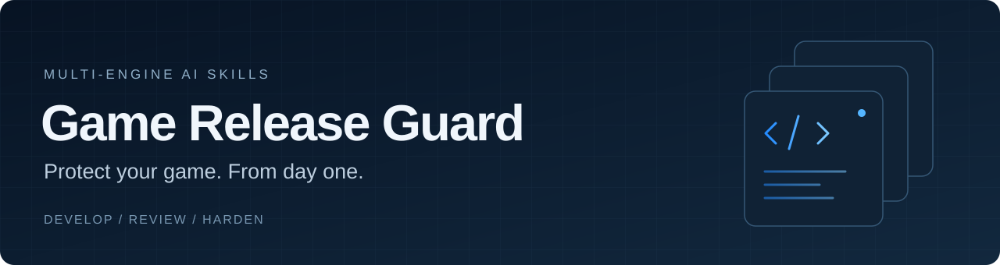

<p align="center"><a href="README.md">简体中文</a> | <a href="README.en.md">English</a></p>



<h1 align="center">Game Release Guard</h1>
<p align="center"><strong>Protect your game. From day one.</strong><br/>从开发第一天开始，保护你的游戏。</p>
<p align="center">面向 Unity、Unreal、Godot、Cocos Creator 和 GameMaker 的统一安全开发与加固 Skill，附 Unity / Unreal 本地发行工具。</p>

<p align="center"><a href="README.md">简体中文</a> | <a href="README.en.md">English</a></p>

[](https://github.com/huangzhuzhu75-bit/game-release-guard/actions/workflows/test.yml)
[](#status)
[](#quick-start)
[](LICENSE)

**Multi-Engine AI Skills V1.0 · 本地工具仍为 Early Development / Advanced Protection Candidate。** P0、P3 和独立 Skill 已整合到 `main`，程序版本仍为 `0.2.0.dev0`；不宣称 Stable / Production Ready。通过 [main ZIP](https://github.com/huangzhuzhu75-bit/game-release-guard/archive/refs/heads/main.zip) 或 Git 获取源码。[Releases](https://github.com/huangzhuzhu75-bit/game-release-guard/releases) 只展示实际发布内容，当前没有稳定发行包。

[快速开始](#quick-start) · [安装 Skill](#ai-skill) · [能力与状态](#advanced) · [安全边界](#boundaries) · [验证证据](#validation) · [支持项目](#sponsoring)

## 核心功能

| 功能 | 能做什么 |
|---|---|
| **AI Secure Development** | 从项目初始化开始，按当前引擎遵守安全开发规范，不额外生成报告。 |
| **Existing Project Protection** | “检查”只读并指出具体问题；明确要求“加固”后，AI 备份并实施适用修改、验证兼容性。 |
| **Unity & Unreal Release Toolkit** | 已有本地 CLI / Tkinter GUI：备份恢复、配置适配、发布检查、显式高级流程与回滚。 |
| **Godot Security Skill** | GDScript 导出、PCK AES-256、自定义模板、密钥管理及补丁/模组来源验证指引。 |
| **Cocos Creator Security Skill** | 按版本区分 Native / Web，处理 Encrypt JS、JSC、脚本备份及资源/热更新检查。 |
| **GameMaker Security Skill** | 区分 Runtime、VM / YYC，检查开发入口、Included Files、客户端数据及发行验证。 |

**一个 Skill 覆盖五种引擎。** Unity / Unreal 有本地 CLI / GUI；Godot、Cocos Creator、GameMaker 本阶段仅由用户的 AI 按 Skill 操作工程，不提供本地自动化加密工具。

<a id="quick-start"></a>
## 30 秒快速开始

**只用 AI？下载 [完整 Skill ZIP](downloads/game-release-guard-skill.zip)，把下方 [通用提示词](#use-with-ai) 交给助手，无需 Python。**

本地工具需要已有 **Python 3.10+**；GUI 另需 `tkinter`。标准库实现，无需 `pip install`，不会自动安装 Python、引擎或保护器。适配面向 Windows / Steam；Linux CI 验证工具逻辑，不代表支持 Linux 游戏构建。

```shell
git clone https://github.com/huangzhuzhu75-bit/game-release-guard.git
cd game-release-guard
python -m steam_release_guard --help
```

项目原名 Steam Release Guard。更名后 Python 包和 CLI 仍使用 `steam_release_guard`，已有 Unity 菜单与私有备份目录名也保留，兼容旧工程。

Windows 可双击 `Launch.cmd` 打开 GUI。找不到 Python 时，将已有解释器路径写入 `.local/python-path.txt` 或设置进程变量 `SRG_PYTHON`。把下面路径换成自己的**测试副本**，先预览：

```powershell
python -m steam_release_guard plan "D:/Games/MyGame-Copy"
python -m steam_release_guard apply "D:/Games/MyGame-Copy" --dry-run --json
```

首次使用真实工程：关闭引擎和同步工具 → 完整备份 → 核验 → 恢复新目录 → 在副本尝试。`apply` 有修改时仍必须再次完成工程外的完整备份，失败就停止；写入前审阅并明确确认，`--yes` 不是自动授权。[备份流程](workflows/backup.md) · [详细操作参考](docs/USAGE.zh-CN.md)

<details>
<summary>备份、检查与恢复命令</summary>

```powershell
python -m steam_release_guard backup "D:/Games/MyGame" --backup-dir "D:/PrivateBackups/MyGame" --dry-run --json
python -m steam_release_guard backup "D:/Games/MyGame" --backup-dir "D:/PrivateBackups/MyGame" --yes --json
python -m steam_release_guard backup-verify "D:/PrivateBackups/MyGame/BACKUP_ID" --json
python -m steam_release_guard backup-restore "D:/PrivateBackups/MyGame/BACKUP_ID" --output "D:/Games/MyGame-Copy" --dry-run --json
python -m steam_release_guard backup-restore "D:/PrivateBackups/MyGame/BACKUP_ID" --output "D:/Games/MyGame-Copy" --yes --json
python -m steam_release_guard audit "D:/Games/MyGame-Copy" --build "D:/Builds/MyGame-v1"
python -m steam_release_guard stage "D:/Builds/MyGame-v1" --release "D:/Release/MyGame-v1" --symbols "D:/PrivateSymbols/MyGame-v1" --dry-run --json
python -m steam_release_guard stage-cleanup "D:/PrivateSymbols/MyGame-v1/srg-stage-journal.json" --dry-run --json
python -m steam_release_guard rollback "D:/Games/MyGame-Copy" --dry-run --json
python -m steam_release_guard build-script "D:/Games/MyGame-Copy" --tool "D:/Engines/Unity/Editor/Unity.exe" --output "D:/Builds/MyGame-v2" --save "D:/Builds/build-my-game-v2.ps1" --dry-run --json
python -m steam_release_guard advanced --help
```

`BACKUP_ID` 换成返回的真实目录名。恢复目标必须不存在；stage 的三个目录不能嵌套，发布/私有符号目录必须新建或为空。`audit` **会写 HTML/JSON 报告**，即使带 `--json`；AI 默认只读检查不应自动调用它。构建脚本只生成、不执行。旧 CLI、GUI、报告与回滚入口保留。

[Unity](workflows/unity-release.md) · [Unreal](workflows/unreal-release.md) · [发布包检查](workflows/security-audit.md) · [回滚与清理](workflows/rollback.md)
</details>

<a id="ai-skill"></a>
## AI Skill：交给你常用的 AI

**同一份 Skill，同一个提示词。** 点击下方任意 AI 入口，跳到通用使用方式；其他能读取 Markdown 的助手也走相同流程。

<p>
  <a href="#use-with-ai"></a>
  <a href="#use-with-ai"></a>
  <a href="#use-with-ai"></a>
  <a href="#use-with-ai"></a>
  <a href="#use-with-ai"></a>
  <a href="#use-with-ai"></a>
  <a href="#use-with-ai"></a>
  <a href="#use-with-ai"></a>
  <a href="#use-with-ai"></a>
  <a href="#use-with-ai"></a>
  <a href="#use-with-ai"></a>
  <a href="#use-with-ai"></a>
  <a href="#use-with-ai"></a>
  <a href="#use-with-ai"></a>
  <a href="#use-with-ai"></a>
  <a href="#use-with-ai"></a>
  <a href="#use-with-ai"></a>
  <a href="#use-with-ai"></a>
  <a href="#use-with-ai"></a>
  <a href="#use-with-ai"></a>
  <a href="#use-with-ai"></a>
  <a href="#use-with-ai"></a>
</p>

<a id="use-with-ai"></a>
### 复制给 AI

```text
请读取 https://github.com/huangzhuzhu75-bit/game-release-guard 的 README.md 和 skills/game-release-guard/SKILL.md。
为当前游戏项目安装并使用整个 game-release-guard Skill 目录，包括 engines/ 和 LICENSE；支持原生 Skill 时使用项目级安装，否则按 Markdown 阅读。
先识别引擎和版本，只加载对应引擎文档。保留已有指令，不覆盖同名文件，不改全局配置、不安装额外软件。
安装后说明实际路径，等待任务：我说“检查”就只读；明确要求“加固”时，在范围内备份后实际修改和验证。不擅自上传工程或生成独立报告。
```

**也可以直接下载：** [独立 Skill ZIP](https://github.com/huangzhuzhu75-bit/game-release-guard/raw/refs/heads/main/downloads/game-release-guard-skill.zip) · [SKILL.md](skills/game-release-guard/SKILL.md) · [LICENSE](skills/game-release-guard/LICENSE)

ZIP 包含一个核心 Skill、五份引擎知识、MIT 许可及中英文说明，共 11 个文件，无需 Python。保留整个目录；AI 识别项目后只读对应引擎文档。无法联网时提供本地目录，核心正文为中文，可要求用你的语言回复。

[中文使用说明](skills/game-release-guard/INSTALL.md) · [English guide](skills/game-release-guard/INSTALL.en.md) · [提示词示例](skills/game-release-guard/EXAMPLES.md)

## Unity 功能

- Unity 6 Editor-only 入口安装到 `Assets/SteamReleaseGuard/Editor/`，安装本身不改 `PlayerSettings`。专用菜单构建 Windows x64 IL2CPP、非开发版本，关闭脚本调试/Profiler。
- 只校验本工具自己的构建入口；普通 Build、自定义流水线、Addressables、AssetBundles 需另行集成。当前拒绝自定义 Build Profile，避免忽略场景和设置覆盖。
- 正常退出恢复设置；强退/崩溃后须人工检查。Obfuz 构建只在核验过的备份恢复副本执行。
- Obfuz 4.0.0 使用明确类型名单、排除名单，默认保留字段，保存私有映射和程序集证据。字符串/控制流保护暂拒绝启用，没有 metadata 加密。
- IL2CPP 仍有可分析的原生代码、字符串和 metadata；不要删除 `global-metadata.dat` 或运行必需的插件。

## Unreal 功能

- 基础适配提供 Shipping、关闭随包调试文件及配置检查；GUID/源码引擎关联不能视为已识别版本。平台覆盖、Target 规则和 UAT 日志需另行检查。
- 高级 schema 2 明确选择 `pak-only` 或 `pak+iostore`，各 CryptoKeys 开关独立，保留密钥和回滚。当前 Windows/UAT profile 的 `iostore-only` 未验证，写入前停止；旧 schema 1 不自动迁移。
- Pak / IoStore 独立检查版本、帮助参数和记录。UE 5.6 IoStoreUtilities 使用官方 `UnrealPak.exe IoStore` 模块入口；缺工具、版本或参数不符记 NOT_VERIFIED。
- 基础兼容参数 `--encrypt-pak-index` 会设置 `UsePakFile=True` 并保留 `bUseIoStore`，使用前必须审核这一容器变化；索引加密不等于资源主体或 IoStore 加密。
- AES 只检查已有非零 32 字节密钥；签名字段编码检查不是 RSA key 对/签名有效性证明。不生成或轮换生产密钥，不自动开启全资源加密。

## Godot、Cocos Creator 与 GameMaker

[Godot 4.x](skills/game-release-guard/engines/godot.md)：PCK AES-256 需要同密钥自编译模板，GDScript token/压缩不是加密。

[Cocos Creator 3.x / 4.x](skills/game-release-guard/engines/cocos-creator.md)：Native Encrypt JS 要核验 JSC 与 script-backup 排除，不能套用 Web。

[GameMaker](skills/game-release-guard/engines/gamemaker.md)：按 Runtime 和目标评估 YYC，原生编译不等于资源加密。

明确要求加固后，AI 可在备份后实施适用的代码/配置修改；实际效果仍需用户环境的构建和运行证据。本次只做合成项目的 Skill 行为验证，没有新增引擎适配器或真实构建。

<a id="advanced"></a>
## 高级保护：能力与状态

<a id="status"></a>
**Implemented** = 代码已提供；**Tested** = 指定范围已测试；**Not Verified** = 缺实际证据；**Not Implemented** = 尚未提供。实现、测试和保护效果是不同层级。

| 能力 | 已实现 / 已测试 | 未验证 / 未实现 |
|---|---|---|
| 备份、事务、回滚、CLI / GUI | **Implemented · Tested**：合成工程、失败恢复、真实 Tk 回调 | 不保证硬件断电、工程外依赖或跨主机恢复 |
| Obfuz 适配 | **Implemented · Tested**：合成测试；Unity 6000.6.6f1 + 固定源码 API 编译 | **Not Verified**：混淆构建、启动、反射、存档、RPC、插件 |
| IL2CPP / 原生模块检查 | **Implemented · Tested**：PE、依赖、metadata 头、敏感候选 | **Not Implemented**：metadata 加密；**Not Verified**：IL2CPP 游戏运行 |
| Pak / IoStore | **Implemented · Tested**：策略、密钥保留、独立调用/证据的合成测试 | **Not Verified**：真实 UE 加密/签名、资源加载、DLC、补丁 |
| A/B/C 资源分级 | **Implemented · Tested**：分类及成本建议 | **Not Implemented**：自动分块、分级加密、加载器改写 |
| 完整性 / DRM 产物 | **Implemented · Tested**：SHA256、外部可信 pin、build-id、变化和 PE 检查 | **Not Implemented**：游戏内自动集成；**Not Verified**：Steam Wrapper / 测试分支 |
| 客户端安全检查 | **Implemented · Tested**：文件/行号候选、已有保护线索 | 启发式检查，不能证明服务端安全或漏洞可达性 |
| 性能 / 三层验收 | **Implemented · Tested**：样本、证据哈希、指标对照 | **Not Verified**：真实启动、加载、内存、CPU、包体、补丁、崩溃、联机及存档性能 |

高级操作通过显式 `advanced` 命令启用，GUI 基础适配不会默认运行它们。[P3 工作流](workflows/advanced-protection.md) · [第三方来源与许可](docs/P3-REVIEW.md) · [metadata 边界](docs/P3-METADATA.md)

<a id="boundaries"></a>
## 安全边界

**配置 ≠ 构建产物 ≠ 真实运行。** 退出码 0、扩展名、Shipping、IL2CPP、压缩或索引加密都不是防破解证明。`REVIEW` / `NOT_VERIFIED` 不升级为 PASS；`RECORDED_PASS` 只表示声明与证据文件匹配，不是独立实机验收。

- 不是反作弊系统、资源加密壳或反盗版保证。重要交易、奖励、权限和结算须由可信服务端验证；客户端秘密可被分析。
- 本地工具不上传工程；云端 AI 的数据使用和第三方引擎/插件行为需另行确认。Skill 不是离线隔离或权限沙箱。
- **Steam DRM 是明确例外**：独立的 `scripts/Invoke-SteamDrm.ps1` 会上传 EXE 给 Valve，必须明确授权并使用 `-AcknowledgeExecutableUpload`。保留原 EXE，不上传 depot、不自动发行；在线/离线和测试分支重新安装仍需实测。
- 备份、日志、报告、映射、符号、Crypto.json 保持私有并放在 depot 外；备份未做静态加密。报告不复制密钥值，但路径也可能保密。
- 完整备份包括工程内隐藏文件、`.git`、缓存和构建，不涵盖外部依赖/存档/引擎；拒绝链接和连接点，不保证 ACL、备用数据流等元数据。恢复只创建新目录。
- 不删除未知文件、不改密钥。冲突、损坏或 INCOMPLETE 状态应停止；回滚不强行覆盖后续改动。stage 需要支持硬链接的文件系统，失败清理只处理已核实副本，无续传；本机锁不阻止外部编辑器，不协调网络盘/跨主机。
- “一键”不包括安装引擎、兼容性证明、Steam 上传或上线批准。存档、反射、联机、DLC、补丁与性能仍需真实构建验证。

[安全政策](SECURITY.md) · [完整操作限制](docs/USAGE.zh-CN.md) · [发布人工检查表](docs/RELEASE-CHECKLIST.md)

<a id="validation"></a>
## 测试和验证

```shell
python -m unittest discover -s tests -v
python -m compileall -q steam_release_guard
```

CI 覆盖 **Windows / Linux × Python 3.10 / 3.12**：行为、备份恢复、事务、文档命令、模块编译；Windows 另检查 PowerShell 语法。Linux 无桌面显示时跳过 GUI 和 Windows 文件占用测试；Windows CI 执行这些项目。本机 Windows 10 的旧 symlink 测试受权限限制跳过。

PR #2 和更新后的 PR #1 矩阵均通过；当前提交看顶部实时 CI 徽章与 [Actions](https://github.com/huangzhuzhu75-bit/game-release-guard/actions)。合成夹具不是实际游戏，API 编译不是引擎构建或游戏运行。当前未发布 Stable 版本。

[五引擎 Skill 验证](docs/MULTI-ENGINE-SKILL-VALIDATION.md) · [P0 验证](docs/P0-ACCEPTANCE-20261125.md) · [备份验证](docs/FULL-BACKUP-VALIDATION-20261125.md) · [P3 验证](docs/P3-VALIDATION.md) · [Skill 验证](docs/SKILL-VALIDATION-20261125.md)

## 目录结构

```text
steam_release_guard/        CLI, GUI, backup, transactions
  advanced/                 Opt-in adapters and evidence checks
adapters/                   Unity / Obfuz Editor bridges
skills/game-release-guard/   Core Skill + engines/, installation, examples, license
workflows/                  Backup, engines, inspection, rollback
docs/                       Sources, validation, detailed usage
downloads/                  Standalone Skill ZIP (no toolkit required)
scripts/                    Launcher, API checks, Skill packaging, Steam DRM
tests/                      Behavioral, recovery and documentation tests
```

## License

[MIT](LICENSE)，可用于商业项目；第三方引擎、SDK、保护器仍适用各自许可证。本仓库不分发商业保护器或引擎二进制。[来源记录](docs/SOURCES.md)

Unity、Unreal、Steam 是各自权利人的商标，本项目与其无隶属或背书关系。

<a id="sponsoring"></a>
## 支持项目

赞助帮助持续维护 Skill、发行工具、文档和兼容性测试。**核心 Skill、源码和正常安全更新继续免费。**

| GitHub Sponsors | Ko-fi | Buy Me a Coffee | Patreon |
| --- | --- | --- | --- |
| [赞助说明](SPONSORING.md#github-sponsors) | [赞助说明](SPONSORING.md#ko-fi) | [赞助说明](SPONSORING.md#buy-me-a-coffee) | [会员与赞助说明](SPONSORING.md#patreon) |
| 待配置 | 待配置 | 待配置 | 待配置 |

四个入口目前均为说明页，尚未配置付款链接；真实公开主页确认后才启用 Sponsor 按钮。[赞助方案、可选档位与费用](SPONSORING.md) · [English](SPONSORING.en.md) · [维护者启用步骤](SPONSORING.md#activation)

## 贡献与反馈

欢迎最小合成复现、文档改进和带版本/证据的兼容性结果。先读 [CONTRIBUTING.md](CONTRIBUTING.md)，保留旧测试、备份/回滚与证据边界。[提交 Issue](https://github.com/huangzhuzhu75-bit/game-release-guard/issues) 前移除源码、资源、密钥及个人信息；安全问题按 [SECURITY.md](SECURITY.md) 处理。未启用 Discussions，不展示其入口。

---

[简体中文](README.md) | [English](README.en.md)
