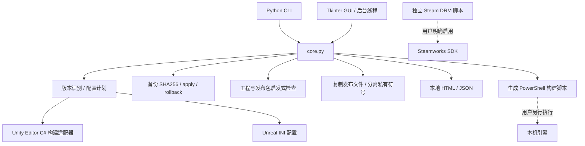

# V2 P0 实施前审查

审查基线：v0.1.0 / `f87d8df`，2026-11-25。范围：P0 稳定性和轻量 Markdown 适配。P1—P4 等待人工验收后单独实施。

## 1. 现有架构

## 2. 已实现

- Python 标准库 CLI、Tk 界面，本地报告；无网络服务和遥测。
- Unity 6：安装 Editor 适配器，生成 Windows IL2CPP 非开发构建命令。
- Unreal 5：Shipping、排除调试文件；使用已有合法密钥的可选 Pak 索引加密。
- 原始文件备份、SHA256 核验、冲突感知回滚；保留无关 INI 配置。
- 源码调试候选、发布包私有文件/符号/散装资源检查；人工事项仍为 REVIEW。
- 分离私有符号，生成引擎命令；独立、显式启用的 Steam DRM Wrapper 脚本。
- 基线 33 个测试：本机 32 通过，1 个因 Windows 符号链接权限跳过。历史 CI 四组合通过；这些不能证明真实游戏的保护效果。

## 3. 已发现的问题

- 缺少跨进程锁；同时执行写入任务会竞争。
- 备份日志只有 schema 1，缺少文件数量、完整性校验与完整的失败状态。
- 计划与备份之间的外部编辑可能造成过期配置覆盖；备份准备失败未清理。
- 回滚中途失败未记录恢复状态；无磁盘空间预检。
- stage 中断后遗留的目录没有明确的 INCOMPLETE 标识，也没有安全清理入口。
- GUI 未捕获意外异常，可能永久禁用按钮；无取消和阶段进度。
- CLI 输出不统一，缺少写入预览与确认。

## 4. 与企划的差距

本次补齐上述 P0 机制及 AI 文档入口。混淆、元数据保护、真实 UE/Pak/IoStore 验证、服务端权威逻辑、SteamPipe 发布状态机、保护等级模板均未实现。不得用配置成功或合成测试替代真实引擎、存档、联机及 Steam 分支验收。

## 5. 兼容性影响与约束

- CLI 写操作增加 `--dry-run` 和 `--yes`；无人值守脚本必须先审阅预览，再显式确认。
- 新事务采用 schema 2；读取旧 schema 1 回滚记录时仍验证所有文件及备份，不能声称旧记录具备日志完整性保护。
- stage 增加事务标记；只提供安全清理失败副本，不删除原构建。
- 使用保守的本机写入锁串行化写任务，避免旧 stage API 无工程参数导致漏锁；跨主机共享目录不在支持范围。
- 保留原 CLI 命令、GUI、适配器、报告与全部旧行为测试。改变确认流程时只为 GUI 测试提供显式确认，不删除其断言。

## 6. 第三方候选与选择

2026-11-25 读取 GitHub 元数据：[filelock](https://github.com/tox-dev/filelock) 991 stars / MIT，近期有维护；[portalocker](https://github.com/wolph/portalocker) 331 stars / BSD-3-Clause，未达到用户优先的 500 stars 门槛。它们是跨平台锁的候选，未安装、未复制源码，未声称已验证其运行兼容性。

P0 保留标准库优先架构，使用 Python 的 [msvcrt.locking](https://docs.python.org/3.12/library/msvcrt.html#msvcrt.locking)（Windows）和 [fcntl.flock](https://docs.python.org/3.12/library/fcntl.html#fcntl.flock)（POSIX），以真实子进程竞争和强制退出测试验证。SHA256 只检测意外损坏，不是对恶意篡改的认证。

P1 的混淆器与元数据保护器、P2 的容器工具、P3 的扫描器留待各自阶段按精确版本/许可/实际引擎测试选择，本次不提前安装或集成。

AI 适配采用仓库内 Markdown。Claude Code、Gemini CLI 未安装，按用户决定不安装；提供项目入口和手动阅读流程，不标记原生 Skill 识别通过。不提供 AI 管理系统。
